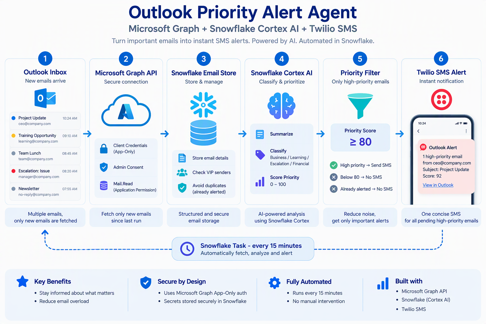

# Outlook Priority Alert Agent

A Snowflake-based email prioritization project that automatically identifies important Outlook emails and sends a mobile alert through Twilio.

The project uses Microsoft Graph to fetch only new Outlook messages, Snowflake to store and process them, Cortex AI to classify, summarize and prioritize each message, and Twilio to notify the user when an unsent email reaches the priority threshold.

<p align="center">
  
</p>

> Visual in this repository was generated with Microsoft Copilot.

## Use Case

A busy inbox can make important messages easy to miss. This project is designed to surface emails such as:

1. Critical business or production escalations
2. Urgent requests requiring action
3. Finance or approval-related messages
4. Important messages from VIP senders
5. Time-sensitive business communication
6. Relevant learning or organizational communication

Instead of repeatedly checking Outlook, the pipeline evaluates new messages and sends an SMS when attention is required.

## Architecture

```text
Outlook Inbox
    -> Microsoft Graph API
    -> Snowflake Email Store
    -> Snowflake Cortex AI
    -> Priority Filter (score >= 80)
    -> Twilio SMS Alert

Snowflake Task runs the pipeline every 15 minutes.
```

## Project Structure

```text
outlook-priority-alerts/
|
|-- README.md
|-- START_HERE.md
|-- .gitignore
|
|-- assets/
|   `-- outlook-priority-alert-agent-architecture.png
|
|-- 01_setup/
|   |-- 01_setup_snowflake.sql
|   `-- 02_create_tables.sql
|
|-- 02_graph_ingestion/
|   `-- 01_graph_email_ingestion.sql
|
|-- 03_ai_prioritization/
|   `-- 01_cortex_ai_scoring.sql
|
|-- 04_twilio_notification/
|   |-- 01_twilio_sms.sql
|   `-- 02_notification_pipeline.sql
|
|-- 05_automation/
|   `-- 01_create_15_minute_task.sql
|
|-- 06_testing/
|   `-- 01_smoke_tests.sql
|
|-- cleanup/
|   `-- cleanup_objects.sql
|
`-- docs/
    |-- CREDENTIALS.md
    `-- OPERATIONS.md
```

## Setup

Follow these steps in order. `START_HERE.md` contains the same execution order as a quick reference.

### 1. Create Snowflake Objects

Create the database, schema, network rule, Microsoft Graph secret, Twilio secret, and external access integration.

```text
01_setup/01_setup_snowflake.sql
```

Replace the secret placeholders locally before running the file. Never commit real secret values.

### 2. Create Tables

Create the email store and optional VIP-sender table.

```text
01_setup/02_create_tables.sql
```

### 3. Connect Outlook through Microsoft Graph

Create the Graph connectivity test and the incremental email loader.

```text
02_graph_ingestion/01_graph_email_ingestion.sql
```

The Microsoft Entra application requires the tenant ID, application/client ID, a client credential, and the Microsoft Graph `Mail.Read` application permission with administrator consent.

Detailed instructions are in:

```text
docs/CREDENTIALS.md
```

### 4. Create Cortex AI Prioritization

Create the procedure that analyzes previously unprocessed emails.

```text
03_ai_prioritization/01_cortex_ai_scoring.sql
```

The AI result contains:

```text
score
category
summary
action
```

The categories used by the project are:

* Escalation
* Finance
* Business
* Learning
* FYI

### 5. Configure Twilio Notification

Create the Twilio SMS procedure:

```text
04_twilio_notification/01_twilio_sms.sql
```

Then create the procedure that selects unsent high-priority emails and orchestrates the complete pipeline:

```text
04_twilio_notification/02_notification_pipeline.sql
```

The default alert threshold is:

```text
Priority score >= 80
```

The pipeline sends one notification for the current batch of qualifying emails instead of intentionally sending one alert for every email.

### 6. Create Automation

Create the Snowflake task:

```text
05_automation/01_create_15_minute_task.sql
```

The task is created suspended so the project can be tested safely before automation starts.

### 7. Test the Project

Run:

```text
06_testing/01_smoke_tests.sql
```

Test in this order:

```text
Microsoft Graph authentication
    -> Incremental email ingestion
    -> Cortex AI scoring
    -> Twilio notification
    -> Complete pipeline
```

### 8. Start Automatic Execution

Only after all tests pass:

```sql
ALTER TASK MAIL_DB.TRIAGE.SMS_PIPELINE_TASK RESUME;
```

The pipeline will then run every 15 minutes.

To stop it:

```sql
ALTER TASK MAIL_DB.TRIAGE.SMS_PIPELINE_TASK SUSPEND;
```

## How Duplicate Processing Is Reduced

The email loader uses the latest stored received timestamp when requesting newer messages and uses the Microsoft Graph message ID during the Snowflake `MERGE` so a stored message is not inserted again.

The notification flow also stores the Twilio Message SID after a successful request. Emails that already have an SMS SID are excluded from later notification batches.

## Example

Suppose three emails arrive:

```text
Email A -> score 25 -> FYI
Email B -> score 62 -> Business
Email C -> score 92 -> Escalation
```

With the threshold set to `80`, Email C qualifies for the mobile alert while Email A and Email B remain available in Snowflake without triggering an SMS.

## Credentials Required

### Microsoft Graph

```text
Tenant ID
Application (Client) ID
Client Secret
Mailbox UPN
```

### Twilio

```text
Account SID
Auth Token
SMS-capable sender number
Destination phone number
```

Use E.164 phone format, for example `+91XXXXXXXXXX`.

Full setup instructions are available in:

```text
docs/CREDENTIALS.md
```

## Snowflake Features Used

* Snowflake Database and Schema
* Snowflake Tables
* Python Stored Procedures
* Snowflake Secrets
* Network Rules
* External Access Integration
* Snowflake Cortex `AI_COMPLETE`
* Snowflake Tasks

## External Services Used

* Microsoft Outlook
* Microsoft Graph API
* Microsoft Entra ID
* Twilio Programmable Messaging

## Security

Real credentials are not intended to be stored in this repository.

Never commit:

```text
Microsoft Client Secret
Twilio Auth Token
Snowflake password
Private keys
```

Before pushing changes, review:

```powershell
git status
git diff --cached
```

## Operations and Troubleshooting

See:

```text
docs/OPERATIONS.md
```

## Cleanup

Cleanup is intentionally separated from the deployment files.

```text
cleanup/cleanup_objects.sql
```

Review cleanup commands before running them because object deletion can be destructive.

## Disclaimer

This project is intended for demonstration and learning. AI-generated email priority scores and summaries are assistive signals and should not replace business judgment. SMS availability depends on Twilio account configuration and destination-country messaging requirements.
